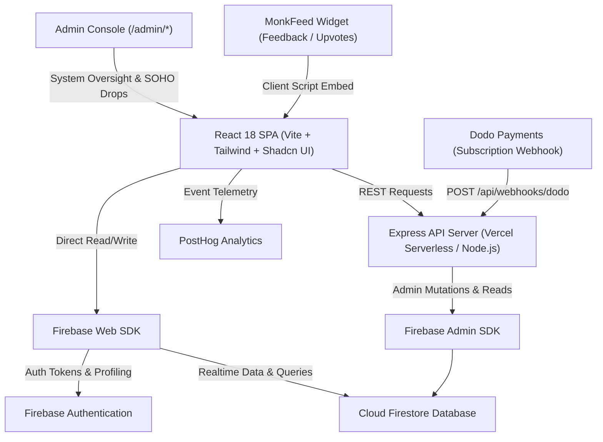

# System Architecture Design

## 1. Overview
**Soho Space** is a proof-of-execution hiring platform connecting startup founders with technical talent through challenge-based skills verification. Rather than relying on traditional resumes, founders post skill-testing challenges with rewards (hires, cash bounties, recognition), while builders submit verifiable proof of work to earn XP, level up, and land roles.

The platform distinguishes between **SOHO Weekly Challenges** (free weekly drops hosted by Soho Space to build public rank & XP) and **Founder Challenges** (posted by startups for actual hiring and bounties).

The system is built as a modern hybrid application combining a client-side rendered Single Page Application (SPA) built with Vite, React 18, and TypeScript, backed by Firebase (Authentication & Firestore) and an Express API server for webhooks and admin operations.

---

## 2. High-Level System Topology

---

## 3. Frontend Architecture

### 3.1 Tech Stack & UI Design System
- **Framework**: React 18 with Vite and TypeScript (Strict Mode).
- **Styling**: Tailwind CSS + Shadcn UI (Radix primitives) + Framer Motion.
- **Routing**: `react-router-dom` (v6) with nested routes, role-guarded layouts (`RequireAuth`, `RequireRole`, `RequireAdmin`), and lazy-loaded page components (`React.lazy` + `Suspense`).
- **State & Data Fetching**:
  - `AuthContext`: Manages Firebase Auth user state, user profile snapshot, role state (`talent` vs `founder` vs `admin`), and subscription status (`starter` vs `pro`).
  - `founder-subscription.ts` & `builder-subscription.ts`: Manages subscription cycle enforcement, 7-day grace periods for expired founder plans, challenge freezing routines, and builder monthly founder-challenge submission counters (4 max on Free tier).
  - `@tanstack/react-query`: Handles client-side query caching and mutations.
  - Custom React Hooks: `use-challenges`, `use-submissions`, `use-messages`, `use-profile`, `use-payouts`, `use-public-stats`.

### 3.2 Key Application Modules
1. **Public Surface**:
   - `/` - Value proposition, interactive role-specific challenge ticker, hero mission pill, dual-track explanation.
   - `/pricing` - Dual-side subscription tiers (Founder Pro vs Builder Pro).
   - `/community` - Public community hub, builder leaderboard, recent proof showcase.
   - `/challenge/:id` - Public challenge detail page for guests and unauthenticated visitors.
   - `/profile/:id` - Shareable public proof-of-work profiles with viral share controls.
   - `/auth` & `/login` - Role selection, email/password signup, and Google OAuth login.
   - Legal Compliance Pages (`/privacy`, `/terms`, `/cookies`, `/disclaimer`).

2. **Authenticated Workflows**:
   - **Role Guard**: `RequireAuth` wrapper ensuring logged-in status, `RequireRole` for role-specific access, and onboarding guard redirecting un-profiled users to `/onboarding`.
   - **Talent Dashboard** (`/dashboard/talent`): Explore bounties, active submissions, submission history, XP & level tracker. Unlimited participation in SOHO Space official weekly challenges; up to 4 founder challenges/month on Free tier.
   - **Founder Dashboard** (`/dashboard/founder`): Manage posted challenges, delete/cancel/stop active challenges, review pending submissions, grade proof-of-work, issue payouts, message builders. 1 active challenge on Free tier; unlimited on Pro tier. 7-day grace period on expired Pro subscriptions before freezing excess challenges.
   - **Direct Messaging** (`/dashboard/messages`): Real-time chat threads between founders and builders.
   - **Challenge Builder**: Multi-step wizard to publish new challenges with criteria weights and compensation details.

3. **Admin Sub-system (`/admin/*`)**:
   - `/admin` - Platform overview metrics, total active users, challenge conversion rates, and health signals.
   - `/admin/builders` - Builder profiles, XP overrides, level inspection, and leaderboard controls.
   - `/admin/founders` - Startup listings, founder verification badges, and company audits.
   - `/admin/challenges` - Platform-wide challenge moderation, freeze/unfreeze actions, and publishing official SOHO Space weekly Monday challenges.
   - `/admin/waitlist` - Early access waitlist subscriber management and conversion tracking.
   - `/admin/reports` - Analytics reports, platform activity metrics, and revenue tracking.
   - `/admin/community` & `/admin/featured` - Leaderboard pinning, featured builder spotlights, and MonkFeed upvote management.

---

## 4. Backend Architecture & API Layer

### 4.1 Server Environment
- **Framework**: Express 5 on Node.js / Vercel Serverless Functions (`api/index.ts` -> `server/index.ts`).
- **Validation**: `zod` schemas for strict request payload validation.
- **Firebase Admin SDK**: Performs elevated operations (bypassing Firestore client rules when authorized), such as atomic server-side submissions, transactional counter updates, subscription lifecycle checks, and webhook processing.

### 4.2 API Endpoints Matrix

| Endpoint | Method | Auth Required | Description |
|---|---|---|---|
| `/api/challenges` | GET | Public | Fetches all open/active challenges ordered by creation date. |
| `/api/challenges/:id` | GET | Public | Fetches challenge details and associated submissions. |
| `/api/challenges` | POST | Founder | Validates schema (`Zod`) and creates a new challenge (checking active tier limits). |
| `/api/challenges/:id/cancel` | POST | Founder | Cancels/stops/deletes an active challenge posted by founder. |
| `/api/submissions` | POST | Builder | Submits proof-of-work, enforcing SOHO (unlimited) vs Founder challenge monthly quotas (4 max on Free tier). |
| `/api/webhooks/dodo` | POST | Webhook Signature | Upgrades user to `pro` subscription upon `order.succeeded` or processes cancellation downgrade to `starter`. |
| `/api/founder-agent/message` | GET/POST | Optional | AI Assistant endpoint for automated founder queries & challenge assistance. |

---

## 5. Authentication & Authorization Security Model

### 5.1 Identity Management
- Authentication handled via **Firebase Authentication**.
- Supports Email/Password credentials and Google Social Sign-In.

### 5.2 Role-Based Access Control (RBAC)
- User role stored in Firestore user document (`/users/{userId}.role`).
- Roles:
  - `talent` (Builder): Submits work to challenges, earns XP, requests payouts.
  - `founder` (Employer): Posts challenges, manages/stops active challenges, grades submissions, messages candidates, issues payouts.
  - `admin` (System Administrator): Moderates platform challenges, publishes SOHO Space official drops, manages featured builders, inspects telemetry.
- Subscription Tiers & Quota Enforcement:
  - **Founder Starter (Free)**: 1 active challenge limit. Expiration of Pro triggers a 7-day grace period warning before freezing secondary challenges to `Frozen` state.
  - **Founder Pro**: Unlimited active challenges, direct messaging, verified badge.
  - **Builder Starter (Free)**: Unlimited participation in SOHO Space Monday challenges + up to 4 Founder challenges per month.
  - **Builder Pro**: Unlimited Founder challenge submissions, direct outreach to founders, Verified Builder badge, priority grading queue.

---

## 6. Integrations & Third-Party Services

1. **Dodo Payments**:
   - Handles checkout and subscription management.
   - Triggers `POST /api/webhooks/dodo` on successful checkout or cancellation to sync Firestore `subscriptionTier`.
2. **MonkFeed Widget**:
   - Embeds user upvotes and feedback widget directly into the app layout.
3. **PostHog Analytics**:
   - Captures user interactions, challenge views, submission conversions, and onboarding funnels.
4. **Vercel**:
   - Deploys frontend SPA build and serverless backend API functions.

