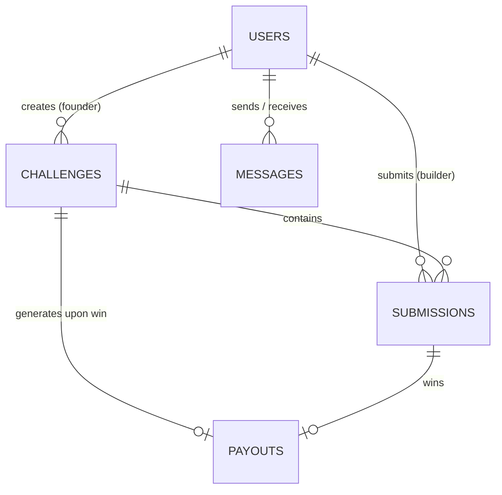

# Database Design Specification

## 1. Overview
Soho Space utilizes **Google Cloud Firestore** as its primary NoSQL document database. Data is structured into top-level collections designed for low-latency queries, realtime subscriptions, and granular security enforcement through Firestore Security Rules.

---

## 2. Collection Schemas & Entity Definitions

### 2.1 Collection: `users`
- **Document ID**: `{userId}` (Matches Firebase Auth `uid`)
- **Description**: User profile data, role definitions, gamification metrics, and subscription state.

#### Document Schema
```typescript
interface UserDocument {
  name: string;
  email: string;
  role: "talent" | "founder";
  subscriptionTier?: "starter" | "pro"; // Default: "starter"
  avatarUrl?: string;
  bio?: string;
  companyName?: string;         // Required for founders
  website?: string;
  githubUrl?: string;
  linkedinUrl?: string;
  xp?: number;                  // Gamification XP for talent
  level?: number;               // Calculated builder level
  challengeCount?: number;      // Created challenge count (for founder limits)
  submissionCount?: number;     // Active submission count (for builder limits)
  createdAt: Timestamp;
  updatedAt?: Timestamp;
}
```

---

### 2.2 Collection: `challenges`
- **Document ID**: `{challengeId}` (Auto-generated UUID or Firestore ID)
- **Description**: Skill challenges posted by startup founders.

#### Document Schema
```typescript
interface ChallengeDocument {
  title: string;
  description: string;
  category: "Tech" | "Growth" | "Hybrid" | "Design" | "Data";
  status: "Open" | "In Progress" | "Judging" | "Completed";
  difficulty: "Beginner" | "Intermediate" | "Advanced" | "Expert";
  xpReward: number;
  rewardType: "Hire" | "Money" | "Recognition";
  rewardLabel: string;
  hireRewardDetails?: {
    position: string;
    compensation: string;
    responsibilities: string;
    skillsRequired: string;
  };
  prize?: string;
  deadline: string; // ISO 8601 string
  maxParticipants: number;
  currentParticipants: number;
  founderId: string;
  founderName: string;
  founderAvatar?: string;
  companyName: string;
  scoringCriteria: Array<{
    name: string;
    weight: number;
    description: string;
  }>;
  requirements: string[];
  createdAt: Timestamp | string;
  updatedAt?: Timestamp | string;
}
```

---

### 2.3 Collection: `submissions`
- **Document ID**: `{submissionId}` (Auto-generated Firestore ID)
- **Description**: Proof-of-work submitted by builders for specific challenges.

#### Document Schema
```typescript
interface SubmissionDocument {
  challengeId: string;
  talentId: string;
  talentName: string;
  talentAvatar?: string;
  submittedAt: Timestamp | string;
  status: "Pending" | "Reviewed" | "Winner";
  score?: number;
  feedback?: string;
  summary: string;
  link: string; // GitHub PR, Vercel demo, Figma link, etc.
}
```

---

### 2.4 Collection: `messages`
- **Document ID**: `{messageId}` (Auto-generated Firestore ID)
- **Description**: Direct message exchanges between founders and builders.

#### Document Schema
```typescript
interface MessageDocument {
  founderId: string;
  builderId: string;
  senderId: string;
  senderRole: "founder" | "talent";
  content: string;
  timestamp: Timestamp;
  read?: boolean;
}
```

---

### 2.5 Collection: `payouts`
- **Document ID**: `{payoutId}` (Auto-generated Firestore ID)
- **Description**: Financial transaction tracking for cash bounties awarded to winning builders.

#### Document Schema
```typescript
interface PayoutDocument {
  challengeId: string;
  winnerSubmissionId: string;
  founderId: string;
  builderId: string;
  builderName: string;
  rewardLabel: string;
  status: "Pending" | "Paid";
  transferReference?: string;
  payoutNotes?: string;
  createdAt: Timestamp | string;
  paidAt?: Timestamp | string;
}
```

---

## 3. Entity Relationship Diagram (ERD)



---

## 4. Query Patterns & Composite Indexes

### 4.1 Access Patterns
1. **Public Challenge Listing**: Filter by `status == "Open"` ordered by `createdAt DESC`.
2. **Founder Dashboard**: Query `challenges` where `founderId == auth.uid` ordered by `createdAt DESC`.
3. **Builder Leaderboard**: Query `users` where `role == "talent"` ordered by `xp DESC`.
4. **Challenge Submissions Review**: Query `submissions` where `challengeId == id` ordered by `submittedAt DESC`.
5. **Direct Messages Thread**: Query `messages` where `founderId == uid` and `builderId == targetUid` ordered by `timestamp ASC`.

### 4.2 Composite Indexes Defined (`firestore.indexes.json`)
```json
{
  "indexes": [
    {
      "collectionGroup": "challenges",
      "queryScope": "COLLECTION",
      "fields": [
        { "fieldPath": "founderId", "order": "ASCENDING" },
        { "fieldPath": "createdAt", "order": "DESCENDING" }
      ]
    },
    {
      "collectionGroup": "users",
      "queryScope": "COLLECTION",
      "fields": [
        { "fieldPath": "role", "order": "ASCENDING" },
        { "fieldPath": "xp", "order": "DESCENDING" }
      ]
    }
  ]
}
```

---

## 5. Data Consistency & Atomic Operations
- **Submission Counting**: Submitting work uses a Firestore `WriteBatch` to atomically write the submission document and increment `currentParticipants` in the target challenge.
- **Pro Tier Webhooks**: Payment webhooks atomically update `/users/{userId}` field `subscriptionTier` to `"pro"`.
