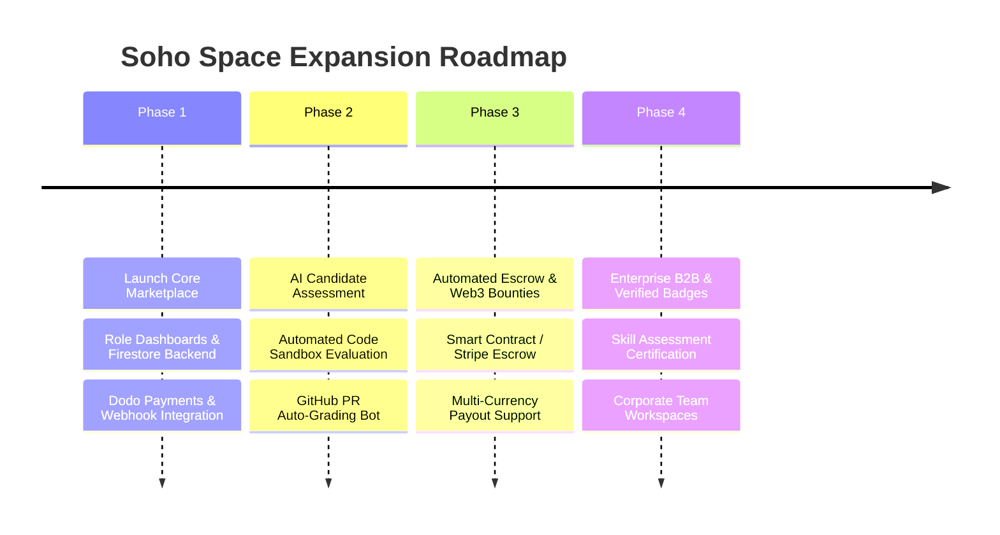

# Product Requirement Document (PRD) — Soho Space

**Document Version**: 1.1.0  
**Product Name**: Soho Space (`soho-proof`)  
**Product Type**: SaaS Marketplace & Proof-of-Execution Hiring Platform  
**Target Audience**: Startup Founders / Hiring Managers & Technical Builders ("Alpha Builders")  

---

## 1. Executive Summary & Vision

### 1.1 Product Vision
**Soho Space** is building the world's premier **Proof-of-Execution Hiring Platform**. We believe traditional resume-based recruiting is broken—resumes are inflated, credentials don't equal execution, and technical screening relies on artificial algorithmic riddles rather than real-world project delivery.

Soho Space replaces traditional job boards with a meritocratic marketplace operating on two distinct tracks:
- **SOHO Weekly Challenges**: Hosted by Soho Space every Monday, completely free for all builders to solve, gain XP, and climb the Top 100 Leaderboard.
- **Founder Challenges**: Posted by verified startup founders with real bounties & job opportunities.

---

## 2. Target Audiences & User Personas

### 2.1 Persona A: "Early-Stage Startup Founder" (The Hiring Side)
- **Profile**: Founder, CTO, or Lead Engineer at a Seed/Series A startup.
- **Pain Points**:
  - Wasting dozens of hours interviewing candidates who look great on paper but fail practical work.
  - Inability to attract elite talent without massive compensation packages.
  - High risk of bad hires consuming critical runway.
- **Goals**:
  - Quickly test candidate execution capabilities using actual startup problems before hiring.
  - Outsource micro-tasks / feature bounties while screening potential team members.
  - Control active challenge volume (1 active challenge on Free tier, unlimited on Pro tier).
  - Easily delete, cancel, or stop challenges when roles are filled or requirements change.

### 2.2 Persona B: "Alpha Builder" (The Candidate / Talent Side)
- **Profile**: Full-stack engineer, frontend wizard, AI developer, growth hacker, or product designer.
- **Pain Points**:
  - Resumes get filtered out by automated ATS keywords without human review.
  - Lack of traditional big-tech branding makes getting interviews difficult.
  - Frustration with non-practical LeetCode interviews that don't test real building skills.
- **Goals**:
  - Complete free SOHO weekly challenges to continuously rank higher on the public Top 100 leaderboard.
  - Perform up to 4 Founder hiring challenges per month on the Free tier (or unlimited on Pro tier).
  - Earn cash bounties and showcase real proof-of-work (GitHub PRs, live deployed apps, Figma specs).

---

## 3. Product Feature & Capability Specifications

---

### 3.1 Public Surface & Auth System
1. **Landing Page (`/`)**:
   - High-impact value proposition highlighting the difference between weekly SOHO ranking challenges and Founder hiring challenges, hero mission pill above the fold, role switcher, and early email capture.
2. **Pricing Page (`/pricing`)**:
   - Transparent plan breakdown for both Founders (Starter vs Pro) and Builders (Starter vs Pro).
3. **Public Community & Leaderboard (`/community`)**:
   - Global Top 100 Builder ranking, featured builders, and recent submission showcase.
4. **Public Builder Profile (`/profile/:id`)**:
   - Shareable proof-of-work showcase displaying verified challenges completed, winning entries, total XP, builder level, and viral social share buttons.
5. **Authentication (`/auth`, `/login`)**:
   - Firebase Auth integration with Email/Password & Google OAuth.

---

### 3.2 Founder Workspace (`/dashboard/founder`)
1. **Challenge Publishing & Quotas**:
   - Create bounties specifying Category (`Tech`, `Growth`, `Hybrid`, `Design`, `Data`), Difficulty, XP Reward, Reward Type, Compensation details, Deadline, and Max Participants.
   - **Tier Quota**: Free tier founders can have **1 active challenge** at a time. Pro tier founders have unlimited active challenges.
2. **Delete / Cancel / Stop Challenge Controls**:
   - Founders can delete, cancel, or stop an active challenge at any time directly from their manage dashboard, immediately releasing their active challenge slot.
3. **Subscription Lifecycle & 7-Day Grace Period**:
   - When a Pro subscription expires without renewal, the system automatically checks for next-cycle payment.
   - If not renewed, the account rolls back to Free tier.
   - The founder receives a 7-day warning banner during which their latest challenge remains active.
   - After 7 days without renewal, any secondary active challenges are automatically **frozen** (`status: "Frozen"`), preserving all candidate submissions and data safely until reactivated.
4. **Submission Review & Payouts**:
   - Interactive grading modal with weighted criteria.
   - Automated payout record creation upon crowning a winner (`Pending` -> `Paid`).

---

### 3.3 Talent / Builder Workspace (`/dashboard/talent`)
1. **Dual-Track Challenge Explorer**:
   - **SOHO Weekly Drops**: Official challenges released every Monday by SOHO Space Admin. Free for all builders with no monthly limits; earns XP and advances leaderboard rank.
   - **Founder Challenges**: Hiring & bounty challenges posted by startups. Free builders can participate in **up to 4 Founder challenges per month**. Upgrading to Builder Pro unlocks unlimited Founder challenges.
2. **Proof-of-Work Submission Engine**:
   - Modal for submitting proof summary link (GitHub repo/PR, Vercel/Netlify link, Loom walkthrough) and execution notes.
3. **Gamification & Leaderboard**:
   - Dynamic level calculation based on accumulated XP:
     $$\text{Level} = \lfloor \sqrt{\frac{\text{XP}}{100}} \rfloor + 1$$

---

### 3.4 Admin Console (`/admin/*`)
- **SOHO Drops Management**: Admin capability to publish official Monday SOHO Space challenges.
- **User Oversight**: Inspect builder profiles, adjust XP, audit founder companies, and manage featured leaderboard spots.
- **Challenge Moderation**: Monitor all platform challenges, un-freeze or archive challenges, and review reported content.
- **Waitlist & Analytics**: Manage early waitlist emails captured from the hero section.

---

## 4. Technical Architecture & Security Summary

- **Frontend**: SPA built with React 18, Vite, TypeScript, Tailwind CSS, Shadcn UI, and Framer Motion.
- **Backend**: Express 5 API running on Node.js / Vercel Serverless Functions (`server/index.ts`).
- **Database**: Cloud Firestore NoSQL database enforcing strict collection-level rules (`firestore.rules`) and composite query indexing (`firestore.indexes.json`).
- **Authentication**: Firebase Authentication with role-guarded routing (`RequireAuth`, `RequireRole`, `RequireAdmin`).
- **Webhooks**: Automated subscription upgrades & cycle checks via Dodo Payments (`POST /api/webhooks/dodo`).

---

## 5. Monetization Model & Commercial Strategy

### 5.1 Pricing Tiers

| Tier | Target User | Price | Features & Quotas Included |
|---|---|---|---|
| **Founder Starter** | Early Founders | **Free** | 1 Active Challenge limit, cancel/delete active challenge controls, access to public submissions, basic grading. |
| **Founder Pro** | Scaling Startups | **\$49 / month** | Unlimited Active Challenges, 7-day grace period on cycle renewal, Direct Messaging with candidates, Featured challenge placement. |
| **Builder Starter** | Candidates | **Free** | **Unlimited** SOHO Weekly Challenges + **4 Founder Challenges / month**, public proof profile, XP & leaderboard access. |
| **Builder Pro** | Active Jobseekers | **\$19 / month** | **Unlimited** Founder Challenges, direct outreach to founders, Verified Builder badge, priority grading queue. |

### 5.2 Enterprise & Bounty Transaction Fee Roadmap
- **Bounty Escrow & Placement Fee**: 10% processing fee on cash bounty rewards.
- **Success Hire Fee**: Optional fixed bounty ($500 - $1,500) paid by founders upon successful full-time hire via the platform.

---

## 6. Comprehensive Marketing & Growth Strategy

To establish Soho Space as the dominant proof-of-work hiring standard, we employ a **dual-sided flywheel strategy** balancing founder demand with builder supply.

---

### 6.1 Founder Acquisition Strategy (Demand Side)

1. **Cold Outreach & Founder Communities**:
   - Target Y Combinator, Techstars, Antler, and South Park Commons founders via automated personalized cold email and X/Twitter DMs.
   - Positioning pitch: *"Stop reading 200 generic resumes. Post a 48-hour micro-challenge and get 5 working prototypes built for your startup."*
2. **Product Hunt & Hacker News Launch**:
   - Host dedicated PH launch highlighting "The End of Resumes".
   - Submit "Show HN: Soho Space – Hire engineers based on real code, not LeetCode".
3. **Founder Content Marketing & Case Studies**:
   - Publish teardowns of real startup hires made via proof-of-work vs traditional hiring costs.
   - Partner with early-stage VC funds and incubators to offer Founder Pro free for 3 months to portfolio companies.

---

### 6.2 Builder Acquisition & Community Growth (Supply Side)

1. **University & Developer Ecosystem Partnerships**:
   - Partner with coding bootcamps (Hack Reactor, App Academy) and university tech clubs (CS societies).
   - Position Soho Space as the ultimate portfolio builder where students get paid while gaining real experience.
2. **Hackathon Integration & Bounty Host**:
   - Sponsoring/hosting monthly virtual hackathons on Soho Space with cash prize pools ($1k–$5k).
   - Winners receive guaranteed founder interviews and Pro tier access.
3. **Viral Proof Profile Sharing (The Brag Loop)**:
   - Auto-generate sleek social preview cards (OG Images) when builders level up or win a challenge.
   - One-click share to LinkedIn/Twitter: *"Just leveled up to Level 5 Builder on @SohoSpace after solving the AI Rag Challenge!"*

---

### 6.3 SEO & Organic Growth Playbook

1. **Programmatic Challenge Pages**:
   - Dynamically index challenge categories (`/challenges/category/tech`, `/challenges/category/ai`).
   - Programmatically build indexable landing pages targeting keywords like *"React Freelance Bounties"*, *"AI Challenge Hires"*, *"Proof of Work Developer Jobs"*.
2. **Public Builder Showcase Canonicalization**:
   - Optimize builder public profiles (`/profile/:id`) for candidate name searches, serving as a live dynamic resume.

---

## 7. Key Performance Indicators (KPIs)

1. **North Star Metric**: **Monthly Verified Executions (MVE)** — Number of completed challenge submissions graded by founders.
2. **Founder Metrics**:
   - Challenge Creation Rate & Active Challenge Volume.
   - Founder Pro Subscription Conversion Rate.
   - Average Submissions Received per Challenge.
3. **Builder Metrics**:
   - Monthly Active Builders (MAB).
   - Submission Completion Rate (Submissions / Challenge views).
   - Builder Pro Subscription Conversion Rate.
4. **Marketplace Metrics**:
   - Time-to-First-Submission (target < 24 hours).
   - Hire Conversion Rate (% of challenges resulting in a hire or payout).

---

## 8. Product Roadmap & Future Expansion

### Phase 1: Core Foundation (Current Release)
- Dual-role dashboard system (Founder vs Talent).
- Challenge creation wizard & multi-criteria scoring.
- Direct messaging & payout tracking.
- Dodo Payments subscription webhooks.

### Phase 2: AI-Powered Evaluation & Automated Testing (Q3 2026)
- **AI Code Reviewer**: Integrated LLM agent evaluating submission code quality, security vulnerabilities, and adherence to requirements before founder review.
- **GitHub Bot Integration**: Auto-check submitted PRs against automated unit tests and continuous integration (CI) pipelines.

### Phase 3: Automated Escrow & Financial Systems (Q4 2026)
- **Bounty Escrow**: Pre-fund cash bounties into platform escrow upon challenge publish to guarantee builder payouts.
- **Multi-Currency & Web3 Payouts**: Support USDC/Crypto payouts alongside Stripe/Bank transfers for international builders.

### Phase 4: Enterprise & Verified Skill Credentials (2027)
- **Soho Certified Badges**: Issued soulbound/verified credentials for builders completing top-tier challenges.
- **Enterprise Team Accounts**: Multi-seat founder accounts with ATS integrations (Greenhouse, Lever).
